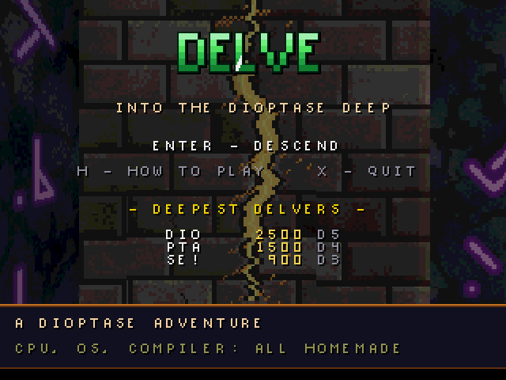
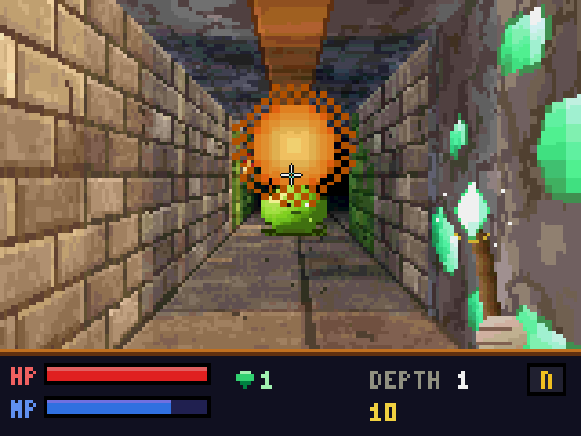
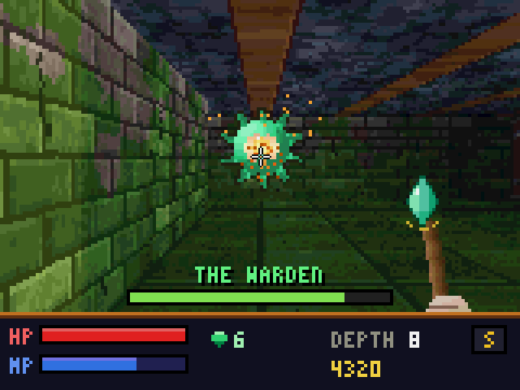
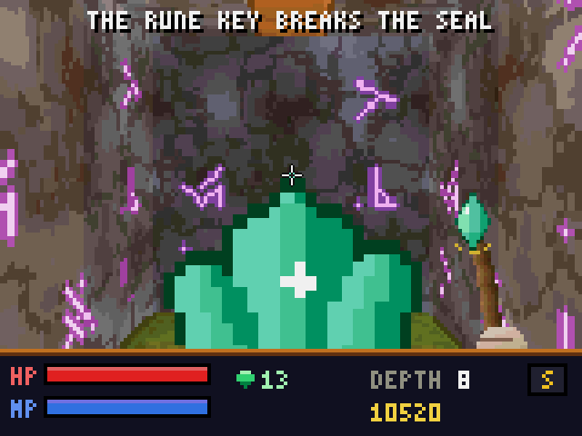

# DELVE — Into the Dioptase Deep

A real-time, first-person dungeon crawler for the Dioptase computer: textured
3D corridors, flickering torchlight, monsters, spells you aim with the mouse,
procedurally generated levels, a boss, chiptune music, and a high-score table
saved to disk. Everything — code, art, music — is generated or written for
this machine; the game runs as an ordinary user program on Dioptase-OS.

| | |
| --- | --- |
|  |  |
|  |  |

## Running it

From `Dioptase-OS/`:

```sh
make run EMU_VGA=yes
```

then type `delve` at the shell prompt. `make run` builds every program under
`root/`, including this one, into `root/sbin/`.

## How to play

You are a crystal-hunter descending through the eight depths of an ancient
mine. On each depth:

1. Gather the green **dioptase crystals** (score).
2. Find the **rune key**.
3. Carry it to the **sealed door** (the iron door with the gold lock) and
   step through the swirling **portal** behind it to descend.

On depth 8 the key is carried by **the Warden**. Defeat it, break the seal,
and take the **Heart of Dioptase** to win.

| Keys | Action |
| --- | --- |
| `W` `S` / up, down | walk forward / back |
| `A` `D` | sidestep left / right |
| `Q` `E` / left, right | turn (tap to fine-tune, hold to spin) |
| `Shift` | run |
| mouse | aim (the crosshair) |
| left button / `Space` | spark bolt (cheap, fast; `Space` fires straight ahead) |
| right button / `F` | fireball (costly, slow, splash damage) |
| `M` or `Tab` | automap |
| `P` | pause (`X` from the pause panel gives up) |
| `H` (title screen) | how to play |
| `X` (title screen) | quit to the shell |

Mana regenerates over time; red potions restore health, blue ones mana.
Crystals are power as well as score: at 10, 25, 40, 60, and 85 crystals your
sparks, health, mana flow, and fireballs grow stronger for the rest of the
run. Some walls are cracked, with light seeping through — a fireball shatters
them and opens a hidden vault.
Monsters wake when you come near: slimes and bats bite, floating eyes spit
bolts you can sidestep, and wraiths hit hard. Hold a spell key or mouse
button to keep casting as fast as your mana allows. Ctrl-C quits at any time.

Cheats, for exploring the deep levels quickly: `Shift+G` toggles invulnerable
mode, `=` takes the portal immediately, `\` hands the controls to the
autopilot, `` ` `` shows the frame rate (followed by billboards queued and
visible, active lights, and how many processes render the view), and `[`
switches between parallel and single-process rendering.

**Held keys.** Normally the terminal forwards only key *presses*, translated
into characters. DELVE switches it into raw keyboard mode (`ESC [ ? 68 h`,
see `docs/terminal.md`), where every press and release arrives as a two-byte
record, so the game knows exactly which keys are down: you walk while `W` is
held, and turning speeds up the longer you hold it. Ctrl-C still works (the
terminal leaves raw mode and ends the game), and the shell switches raw mode
off again after any program exits.

## How it works

**Three display layers.** The 3D view is 320x192 pixels in the top of the
pixel framebuffer (shown at 2x, so it fills 640x384 screen pixels), which
DELVE maps with `get_pixel_fb()`. The status bar is drawn into the pixel rows
below it, and only redrawn when something on it changes. Text — messages,
menus, the numbers on the status bar — lives in the tile layer above the
pixels, as tiles made from the OS's own 8x8 font with a drop shadow, so it
costs nothing per frame and never flickers. Big headings and the title logo
are tiles too: each is rendered once into a block of spare tiles (the logo's
glint repaints just the columns it crosses). The crosshair is a hardware
sprite, and the staff is drawn into the view itself so it is clipped and
tinted with the scene.

**A TLB-shaped back buffer.** The view is rendered into a back buffer split at
the horizon into two halves, each made of 40 chunks of 8x96 pixels stored
row by row. A wall or sprite column touches one chunk per half, floor casting
fills one 8-pixel column group at a time, and the copy to the framebuffer
moves 16-byte chunk rows. That matters because the TLB has 16 entries and a
miss costs over a thousand instructions: the first layout tried, with
32-row bands, made every tall wall column touch six pages and ran at a third
of the speed.

**Raycasting.** One DDA ray per screen column finds walls and Wolfenstein-style
sliding doors (thin panels on a cell's center plane). Ray directions step
incrementally across the view and their reciprocals come from a table, so a
new camera angle every frame costs little. Floors
and ceilings use row-based floor casting (texture coordinates step linearly
along each screen row). Billboards (monsters,
items, torches, spells) are depth-sorted and clipped against a per-column
z-buffer. Everything is lit through 16 shade tables over a 256-color palette:
distance fog plus point lights (torches, spells, crystals, the portal) that
light walls per column and floors per 8-pixel run.

**No multiply instruction.** The ISA has no hardware multiply, so the hot paths
use a quarter-square table multiplier (`umul16`), a shift/subtract divider,
and incremental arithmetic; the per-pixel loops are hand-written assembly in
`gfx.s`. Texture data is page-aligned so each 4 KiB texture costs one TLB
entry.

**Three cores.** The view is split into three strips of column groups. Two
forked worker processes render two of them while the game process renders the
third, all into a back buffer that lives in a shared file mapping (Dioptase-OS
has no anonymous shared memory, but `MMAP_SHARED` file mappings alias the same
page-cache pages across `fork`; the file is unlinked right after mapping, and
the kernel writes nothing back until the last mapping goes away). Each process
then copies its own strip to the framebuffer, whose mapping the workers
inherit. Workers wait by spinning on a frame counter in that shared page —
blocking pipe reads were tried first and lost to wake-up latency. The first
game also measures both modes and falls back to a single process if parallel
turns out slower (for example with fewer cores).

**Sound.** `audio_start()` forks a synthesizer process that owns the PCM
device: eight voices (wavetables and an LFSR noise channel), a four-channel
tracker for the music, and pitch-swept segment programs for the effects. The
game sends it one-byte commands through a pipe. A heartbeat and a
`SIGNAL_TERMINATE` handler make sure it never outlives the game.

**Attract mode.** Behind the title screen an autopilot plays the game: it
breadth-first searches toward potions, keys, crystals, the seal, and
unexplored space, and turns to fire at monsters in line with it.

**Persistence.** High scores live in `/delve.hi` on the root filesystem;
`make run` copies the image back into `root/`, so they survive between runs.

## Files

| File | Contents |
| --- | --- |
| `delve.h` | shared constants, types, and the screen and back-buffer layout |
| `main.c` | display setup, main loop, input, player, game states, high scores |
| `render.c` | raycaster, floor casting, lighting, billboards, particles |
| `world.c` | level generator, doors, monsters and AI, items, projectiles |
| `hud.c` | status bar, tile-layer text and banners, back-buffer addressing |
| `audio.c` | synthesizer process and its command protocol |
| `autopilot.c` | the computer player for the attract mode |
| `parallel.c` | worker processes that render strips of the view |
| `gfx.s` | hand-written inner loops and arithmetic helpers |
| `assets.s` | generated palette, shade tables, textures, sprites, fonts, music |
| `tools/gen_assets.py` | the generator for `assets.s` (`make assets`; needs numpy) |

`python3 tools/gen_assets.py assets.s --preview <dir>` also writes PNG contact
sheets of the palette, textures, and sprites.
