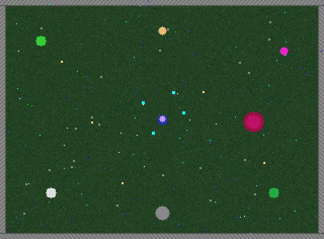
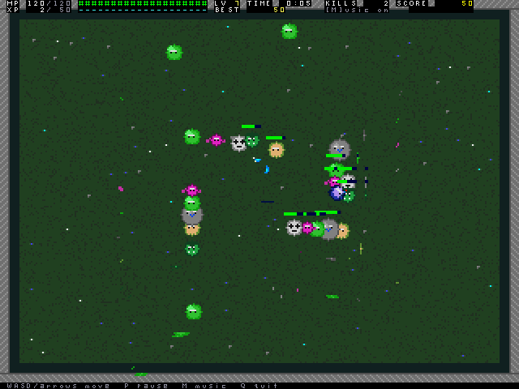

# Emberfall: Warden of the Rift



A fantasy horde-survival arcade game for the Dioptase emulator. You are the
Ember Warden, alone in a meadow against an endless shadow horde. Spells fire
by themselves at nearby foes; you steer, collect blue XP gems, and pick 1 of
3 upgrades every level. How long can you last? A boss stalks you every 90
seconds. Your top five runs persist in `/emberfall/highscores.txt`.

Made by **muse-spark-1.3**.

The image is a host rendering of the arena palette; actual output comes from
the Dioptase VGA device (pixel playfield plus tile HUD plus cursor sprite).

## Play

From the `Dioptase-OS` directory, with the toolchain built:

```sh
make run EMU_VGA=yes EMU_AUDIO_FAST=yes
```

At the guest shell, enter `emberfall`. The VGA window is required because
pacing follows the 60 Hz frame counter. Audio is optional; use
`EMU_AUDIO=no EMU_AUDIO_FAST=no` when no host player exists.

| Key | Action |
| --- | --- |
| W A S D / arrows (hold) | Move (raw keys when available) |
| Enter / click | Start, confirm, retry |
| 1, 2, 3 / click | Pick a level-up upgrade |
| P / Esc | Pause, resume, help back |
| H | How to play (title) |
| M | Mute music |
| R | Restart (pause, game over) |
| Q / Esc | Quit (title, game over) |

Spells: Ember Bolt, Fireball splash, Frost slow, Lightning chain, Holy Nova
ring. Passives: Boots speed, Rune damage, Heart HP plus regen, Magnet pickup,
Tome XP. Foes: slimes, bats, skeletons, orcs, wraiths, golems, and bosses.
The warden sprite turns to face the last move direction (8 pre-rotated
frames), and every level-up card shows its upgrade icon.

Performance notes: bcc lowers `*` `/` `%` to software routines, so the hot
per-frame paths (enemy steering, gem magnet, projectile and player collision,
blitters, HUD numbers) use pointer iteration, shifts, and lookup tables
instead. The e2e frame budget is 100 jiffies; the scripted run averages ~3
with a max of 15.

## Checks

Host rules plus the full-emulator guest check:

```sh
make -C root/emberfall test
make emberfall_guest.summary-test TEST_RUNS=1
make emberfall_e2e.summary-test TEST_RUNS=1
```

The guest check runs the shipping `emberfall --selftest` binary headless. It
exercises rules, upgrades, display mappings, raw-mode traps, and score order
without needing a VGA window. It does not replace a visual playthrough.

The e2e check runs `emberfall --e2e`: 256 scripted frames driven by raw PS/2
words through a stdin pipe, covering movement and aliases, all casts, pause,
help, confirm, upgrade picks, restart, score, streaks, level-up, death, game
over, and best-score persistence. It reads back tile text and pixel words from
real MMIO, asserts zero transparent-marker leaks, times every frame in
jiffies, and dumps the framebuffers to SD1 output. The render below is composited
from one such dumped guest framebuffer with `tools/render_shot.py`, which
follows the emulator's compositor exactly; it is not drawn by hand.



`make test` also builds `tools/dump_art.c`, which renders the sprite art on
the host against stub MMIO, checks the facing map plus art invariants, and
writes `/tmp/facings.ppm` and `/tmp/icons.ppm` for visual review.

## Device contracts

User mode only, via documented Dioptase-OS syscalls. `get_pixel_fb()` maps
320x236 of the pixel framebuffer (rows 0..235, stride 320, `0x0BGR`);
`get_tile_fb()`, `get_tilemap()`, and `get_spritemap()` map the tile and
sprite windows. The tile layer stays transparent over the arena except HUD
and menus; sprite 0 is the menu cursor. `set_keyboard_raw(1)` delivers 16-bit
PS/2 press and release words on stdin; the game falls back to cooked bytes
with a repeat latch when raw mode is unavailable. Mouse motion accumulates
from `getmouse()` into 640x480 screen pixels. Audio mixes a 32-step bass and
lead loop with nine one-shot effects at 25 kHz mono. High scores use fixed
width records (10-digit score, 6-digit time, 6-digit kills, 2-digit level).
