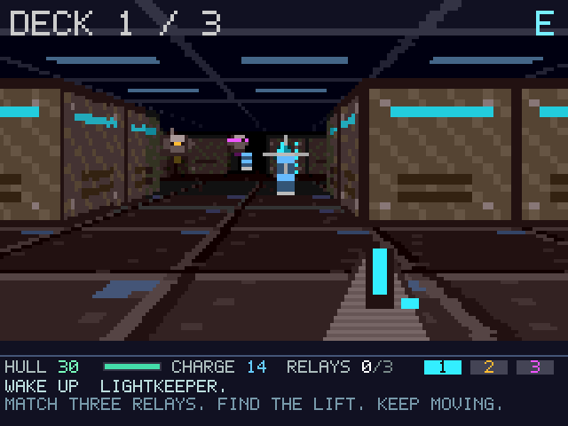

# LUMEN: The Glass Station

A first-person expedition through a silent orbital station. Restore its three
colored relays, outwit the sentries, and bring the last sun home.

LUMEN is an original user program for Dioptase: a textured integer raycaster,
three procedural decks, tactical combat, a scanner map, crew transmissions,
upgrades, and an original synthesized score. No external artwork, music files,
engine, kernel modifications, or host graphics library is needed by the game.



## Play

From this checkout:

```sh
cd Dioptase-OS
make run EMU_VGA=yes
```

At the guest shell, enter:

```text
lumen
```

Press **Enter** to play or **D** on the title screen to watch an autonomous
expedition. Movement takes one cell at a time, with animated transitions.
Enemies act when you move, fire, wait, open a door, or read a transmission.
You can take your time looking, changing colors, and studying the map.

| Key | Action |
| --- | --- |
| W / S, Up / Down | Forward / backward |
| A / D, Left / Right | Turn |
| Z / C | Sidestep left / right |
| Space or F | Fire the prism beam |
| 1 / 2 / 3 | Cyan / amber / magenta beam |
| E or Enter | Open door, read transmission, use lift |
| X or period | Wait and recharge |
| M or Tab | Scanner map |
| H | Field manual |
| P | Pause |
| V | Toggle sound |
| T | Toggle autonomous pilot; movement also takes control |
| R / N | After an ending: retry the seed / start a new seed |
| Q | Return to the shell |

The emulator itself handles Escape as **close window**, so use Q to leave the
game while keeping the OS running.

Match each relay's glow with your beam. A matching shot also does much more
damage to a sentry. Its **!** warning gives you two turns to destroy it or break
its line of fire; sidestepping behind a corner cancels its lock. Shots cost two
charges. Waiting recharges, but enemies take their turns too. Medical caches,
power cells, and crew logs help you survive.

Three lit relays unlock the lift in the southeast chamber. Look for its glowing
arch, or the green map square. Face it from the adjacent cell (or stand on it)
and press E. Between decks, choose hull, beam, or capacitor upgrades. Restore
all three decks to finish the expedition.

## Options

```text
lumen --seed 42
lumen --demo
lumen --silent
```

The default seed is `20261010`; `--seed` accepts decimal digits and wraps to a
32-bit unsigned value. There are no saved-game or asset-file dependencies.

Sound uses the existing 25 kHz mono audio device. `make run EMU_VGA=yes` selects
the emulator's wall-clock audio mode; its host playback requires the audio
player described in the emulator README. To run without host playback:

```sh
make run EMU_VGA=yes EMU_AUDIO=no EMU_AUDIO_FAST=no
```

Then use `lumen --silent`. If another process owns audio, the game explains the
failure in its radio strip and remains playable.

## Build and verification

The OS discovers `root/lumen/Makefile` automatically. To build only the game:

```sh
make -C root/lumen
```

Run the actual optimized guest binary, including deterministic rule tests and
five scenes published to and read back from the real tile/sprite mappings:

```sh
make lumen.test TEST_RUNS=1 TIMEOUT_SECONDS=600 EMU_VGA=no EMU_AUDIO=no
```

The test must report `1/1`. The existing OS test runner does not propagate a
failing summary through its exit status. Its output directory contains guest
PPM captures; compare these pixel-for-pixel against a native build and create
viewable PNGs with:

```sh
make -C root/lumen previews
```

Portable checks and optional host sanitizers:

```sh
make -C root/lumen host-check
make -C root/lumen host-sanitize
root/lumen/build/check --exhaustive
```

The host checks exercise deterministic generation, complete campaigns,
movement, collision, colored beams, relay idempotence, sentry warning/dodge/
death, resource limits, logs, upgrades, every UI mode, extreme render views,
wall occlusion, and PCM synthesis. `--exhaustive` runs 1,000 complete campaigns.
The integration test executes the same game, renderer, and synth with bcc and
basm under the full emulator; host checks alone are not evidence of guest
compiler correctness.

## Implementation contracts

- All game logic runs in a single foreground user process. There are no worker
  threads, custom traps, privileged instructions, or assumptions of POSIX libc.
- [The root ABI specification](../../../docs/abi.md) supplies 16-bit short and 32-bit int, the calling convention,
  four-byte stack alignment, and the CRT trap ABI. No TLS is used.
- [The root memory map](../../../docs/mem_map.md) defines tile entries, `0x0BGR` color, 256 writable 8x8 tiles,
  and 16 writable 32x32 sprites. 240 tiles form a 160x96 view enlarged to
  640x384; ten sprites form the sharper 320x32 radio/status strip.
- The canonical memory map does not specify whether sprite coordinates scale
  with their pixels. This application explicitly follows the current emulator
  and `root/dino` behavior: both scale together. The missing coordinate rule
  should be added to the canonical hardware documentation before targeting a
  different implementation. The canonical mouse-stream section is also absent;
  this application uses keyboard input only.
- The mapping getters and audio ownership/error/partial-write rules come from
  [the OS syscall documentation](../../docs/syscalls.md). PCM remains in an application buffer until its accepted
  prefix is reported; no unwritten suffix is discarded.
- The terminal owns raw keyboard input and forwards press bytes through stdin.
  LUMEN consumes that pipe, falling back to `getkey()` only without a pipe.
  It hides the cursor and drains terminal output before taking over graphics.
  The shell restores its display after the foreground program exits.
- Writes use volatile mapped pointers and stay within each documented region.
  The display has no documented atomic buffer swap; a frame can briefly tear
  during publication. Animation is paced by the VGA counter, which requires
  `--vga` in the emulator. Gameplay remains turn based at any rendering speed.
- The sample loop uses fixed-point lookup tables because multiplication itself
  is a software routine on this ISA. The original score, **Afterlight**, has
  three deck arrangements and synthesized cues; all visuals are procedural.

## Verified results

The optimized guest self-tests and five MMIO capture scenes pass in the full
four-core emulator. All five captured scenes match the native renderer exactly.
AddressSanitizer/UndefinedBehaviorSanitizer pass across 8,204 rendered frames,
624 floor cells, and 128 full campaigns. A separate 1,000-seed campaign sweep
also reaches victory through ordinary game actions. The standard `root-sbin`
build and the selected input, foreground display, audio, and timer OS
regressions pass.

The checked-in screenshots are guest MMIO readbacks. No interactive GUI session
or audible listening test was performed in this environment; input integration
follows the existing foreground games, and PCM is checked numerically.
