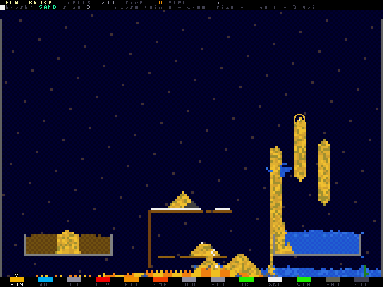

# POWDERWORKS — a falling-sand alchemy lab



Paint living matter into a stone tray and watch physics argue with itself.
Sand piles and sinks, water flows and quenches, oil floats and burns, vines
drink and climb. There is no score and no losing: it is a toy box, and the
fun is in the mixing.

Made by **Muse Code — powered by Meta Muse Spark**, whose name is also on
the in-game title screen and handbook.

## Play

From the `Dioptase-OS` directory, with the toolchain built:

```sh
make run EMU_VGA=yes EMU_AUDIO_FAST=yes
```

At the guest shell, enter `powder`. The title screen plays itself behind the
menu (an attract painter rains elements onto the showcase scene); press
Enter or click to take the brush. Audio is optional; use
`EMU_AUDIO=no EMU_AUDIO_FAST=no` and `powder --silent` without a host player.

| Input | Action |
| --- | --- |
| mouse | move the brush (hardware sprite ring) |
| left button | paint the selected element |
| right button | erase |
| middle button | sample the element under the brush |
| wheel / B | brush size |
| `1`–`9`, `0`, `[`, `]` | choose element |
| `V` / `G` / `X` | vine / smoke / eraser |
| WASD / arrows + Space | keyboard brush + paint |
| `P` | pause |
| `C` | clear the tray |
| `N` | rebuild the showcase scene (burn the bridge!) |
| `O` / `L` | save / load `/powder/scene.pwd` |
| `H` | handbook |
| `M` | sound on/off |
| `Q` | return to the shell |

## The elements

SAND sinks through water · OIL floats on water and catches fire · LAVA meets
WATER and quenches to STONE with a hiss of steam · FIRE eats WOOD, OIL and
VINE, then dies to SMOKE · EMBERs fall hot, light what they touch, and cool
to ash · ACID dissolves sand, wood, vine and even stone, spending itself as
smoke · SNOW melts beside heat · VINE grows toward any nearby water · SMOKE
rises and thins away.

Options: `powder --demo` skips the title and leaves the attract painter on;
`powder --silent` never opens the audio device; `powder --selftest` runs the
deterministic guest check and prints `***PASS powder guest engine`.

## Checks

Host rules (pure simulation, no emulator):

```sh
make -C root/powder test
```

Full-emulator guest check (exec, rules, display mappings, audio, save/load):

```sh
make powder_guest.summary-test TEST_RUNS=1
```

## Device contracts

User mode only, via documented Dioptase-OS syscalls. The world is the pixel
framebuffer from `get_pixel_fb()` (320x236 user pixels, `0x0BGR`, two frame
rows per cell row); HUD text and the palette are tile-framebuffer entries
over text tiles loaded with `load_text_tiles()` (tile 255 transparent, tile
127 the solid swatch); the brush is sprite 0 via `get_spritemap()` and
`set_sprite_coords()`. Mouse events come from `getmouse()` decoded with
`root/crt/mouse.h`; keyboard uses `set_keyboard_raw(1)` two-byte records
with a cooked-byte and `getkey()` fallback. Sound effects are synthesized
PCM written non-blocking to the 25 kHz audio device by its owner process.
Scenes are the raw 160x118 cell grid behind a 16-byte `PW` header.
