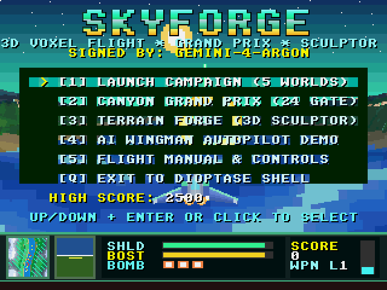
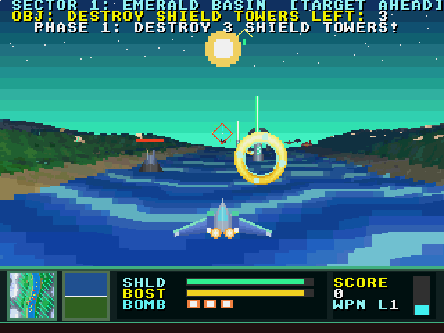

# SKYFORGE — 3D Voxel-Space Canyon Flight, Grand Prix & World Sculptor

**Created and signed by `gemini-4-argon`**

| Home Screen (Attract Flight) | Campaign Flight (Emerald Basin) |
| --- | --- |
|  |  |

**SKYFORGE** is a real-time 3D outdoor Voxel-Space starfighter action game, 24-gate canyon hover-racer, and live 3D terrain sculptor built from scratch as a user-mode program for the Dioptase computer architecture and operating system.

---

## Running SKYFORGE

From `Dioptase-OS/`:

```sh
make run EMU_VGA=yes
```

At the Dioptase shell prompt, run:

```text
skyforge
```

Command-line options:
- `skyforge --demo`: Launch directly into autonomous AI Wingman spectator flight.
- `skyforge --silent`: Run without claiming the hardware PCM audio device.
- `skyforge seed=12345`: Generate worlds from a specific deterministic seed.
- `skyforge --selftest`: Run the deterministic guest verification suite.
- `skyforge --bench`: Run a 120-frame 3D Voxel-Space rendering benchmark in guest jiffies.

---

## Four Integrated Modes

1. **Campaign: Defender of Dioptase (`[1]` on Home Menu)**
   - Fly the 3D polygonal **Aether-Interceptor** through five distinct procedural 3D worlds:
     1. **Sector 1 — Dioptase Emerald Basin**: Crystalline emerald valleys, winding sapphire rivers, stone canyon arches, and scout squadrons.
     2. **Sector 2 — Obsidian Magma Caldera**: Molten lava rivers, basalt cliffs, and magma interceptors.
     3. **Sector 3 — Cryo-Spire Glacial Sea**: Arctic waters, cyan glaciers, diamond peaks, and stealth fighters.
     4. **Sector 4 — Cyber-Trench Nexus**: Synthwave neon contour canyons and hunter-killer squadrons.
     5. **Sector 5 — Leviathan Core**: Final showdown against the **Leviathan Dreadnought**, a colossal airborne fortress protected by four orbiting shield generator pylons.
   - Fly through **Golden Power Rings** to restore shields and upgrade your Twin Plasma Cannons to **Quad Cannons** (Level 2) and **Hyper-Spread Lasers** (Level 3).
   - Launch **Seismic Nova Torpedoes** (`F` or Right-Click) that dynamically carve real 3D craters into the terrain heightmap on impact and obliterate nearby enemies.
   - Trigger a **360-Degree Barrel Roll** (`E` or Middle-Click) to activates your hexagonal deflector field and reflect enemy laser bolts back at attackers.

2. **Canyon Grand Prix (`[2]` or `R` on Home Menu)**
   - High-speed 24-gate slalom race down the winding canyon river against three AI Rival Aces and the clock, with persistent best course times saved to disk.

3. **Terrain Forge — Live 3D World Sculptor (`[3]` or press `T` anytime)**
   - Switch seamlessly between flying your starfighter and sculpting the 3D voxel world in real time at 60 Hz:
     - `1`: **Raise Peak** (sculpt 3D mountain peaks with automatic directional sun-slope shading)
     - `2`: **Carve Gorge** (excavate deep river channels and canyons)
     - `3`: **Smooth Mesa** (level rugged terrain into flat plateaus)
     - `4`: **Volcano Rim** (stamp a raised volcanic caldera with a lava/water crater core)
     - `5`: **Crystal Gem** (paint glowing Dioptase crystal / magma accent veins)
     - `6`: **Lava River** (carve glowing liquid channels)
     - `7`: **Spawn 3D Ring / Arch** (place interactive 3D rings and stone arches into the world)
   - Press `B` to cycle live between all five biome palettes, `O` / `L` to save or load your custom 3D world (`/skyforge/world.sf`), and `T` to drop your starfighter immediately into the world you just sculpted.

4. **Autonomous AI Wingman (`[4]` or press `D` anytime)**
   - Runs live behind the Home Screen title menu and can be toggled on/off at any point during flight with `D`. The AI Wingman steers through canyon rivers, lines up Power Rings and Grand Prix gates, locks onto enemy fighters, fires seismic torpedoes, and barrel-rolls to deflect incoming fire.

---

## Controls

| Input | Action |
| :--- | :--- |
| `W` `S` / `Up` `Down` | Pitch nose climb / dive |
| `A` `D` / `Left` `Right` | Bank roll & yaw turn |
| `Mouse` | Aim 3D crosshair reticle / move Terrain Forge brush |
| `Space` / `Left-Click` | Fire Twin/Quad/Hyper Plasma Cannons (or apply Sculpt Brush in Terrain Forge) |
| `F` / `Right-Click` | Launch Seismic Crater Torpedo (or inverse Sculpt Brush in Terrain Forge) |
| `E` / `Middle-Click` | Perform deflecting 360-degree Barrel Roll |
| `Shift` | Engage Afterburner Boost |
| `Z` / `C` | Airbrake / Hover |
| `V` | Toggle 3rd-Person Chase Arwing View / 1st-Person Cockpit View |
| `T` | Toggle live between Flight Mode and **Terrain Forge 3D World Sculptor** |
| `1`–`7` / `Wheel` | Select Terrain Forge tool / adjust brush radius (`[` `]` also resize brush) |
| `B` | Cycle Biome Palette in Terrain Forge |
| `O` / `L` | Save / Load custom 3D world (`/skyforge/world.sf`) |
| `D` | Toggle Autonomous AI Wingman Autopilot |
| `N` | Advance to next Sector (`1..5`) |
| `M` | Mute / Unmute Audio |
| `P` | Pause / Resume |
| `H` | Open Flight & Sculptor Manual |
| `Q` | Return to Home Menu / Exit to Dioptase Shell |

---

## Technical Architecture

- **TLB-Shaped Column-Group Backbuffer (`render.c`, `gfx.s`)**:
  The 320x192 3D viewport is rendered as 160 double-pixel columns grouped into 20 column-groups of `8 double-columns x 192 rows` (`6,144` bytes = 1.5 pages per group). Marching a column from bottom to top steps by a uniform `-32` byte stride (`8` words) with zero half-split branches and touches at most two 4 KiB pages, keeping the entire working set (code, stack, column-group, height-projection LUT, fog palette, and terrain grid) inside the 16-entry Dioptase TLB.
- **Zero-Multiply Voxel Raymarching**:
  Before marching each frame, `prepare_frame_tables()` precomputes the projected screen row `frame_y_lut[step][height]` (`3,072` bytes) and the distance-fogged pixel-pair palette `frame_pal_words[4][256]` (`4,096` bytes). Inside the 48-step raymarching loop across all 160 columns, ray coordinates advance via shifts and adds only, with sub-cell bilinear height smoothing and micro-texture shading on near steps.
- **Per-Column Ridge Occlusion Buffer**:
  As terrain columns march front-to-back, the highest horizon silhouette row at 16 depth buckets is recorded in `occl_top[160 * 16]`. All 3D entities (Power Rings, Grand Prix Gates, Stone Arches, Crystal Spires, Enemy Fighters, and the Leviathan Boss) plus projectiles and particles are depth-tested per column against `occl_top` so objects behind mountain ridges are naturally occluded.
- **Three Hardware Display Layers**:
  - **Pixel Framebuffer (`get_pixel_fb`, rows `0..231`)**: 3D Voxel-Space viewport (`rows 0..191`) plus the graphical Cockpit Flight Deck (`rows 192..231`) featuring a live 32x32 Topographic Minimap Radar, banking Artificial Horizon (ADI), Shield/Boost bars, Bomb indicators, and Altimeter.
  - **Tile Framebuffer (`get_tile_fb`, `get_tilemap`)**: Shadowed 8x8 HUD typography, menu panels, and the 3x-scaled metallic gradient `SKYFORGE` title banner. Tile row 29 masks unmapped pixel rows `232..239`.
  - **Hardware Sprites (`get_spritemap`)**: Sprite 0 renders the 32x32 aiming reticle; Sprite 1 renders the target lock-on diamond over locked hostile fighters.
- **Forked 25 kHz 4-Voice PCM Audio Synthesizer (`audio.c`)**:
  A dedicated child process pinned to Core 0 synthesizes five multi-channel musical themes (Lead, Arpeggiator, Bass, Percussion) and twelve polyphonic sound effects into the 25 kHz 16-bit mono PCM ring buffer, communicating with the game process over a non-blocking command pipe with a keepalive heartbeat and `SIGNAL_TERMINATE` cleanup.

---

## Verification

Run the host unit tests (simulation, terrain sculpting, combat, 3D voxel rendering, and PCM audio synthesis):

```sh
make -C root/skyforge test
```

Run the full-emulator guest self-test:

```sh
make skyforge_guest.summary-test TEST_RUNS=1
```
