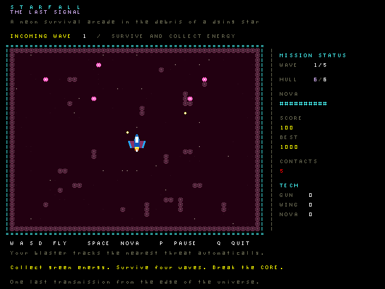

# Starfall: The Last Signal



A five-wave survival arcade game for the Dioptase emulator. Fly an interceptor
through procedural asteroid fields, let its blaster track nearby enemies, collect
energy to recharge a nearby-shot-clearing nova, pick salvage upgrades between waves,
and destroy the Breaker core. Enemies, shots, and debris use custom 8×8 tile
art; the ship and core use 32×32 hardware sprites. Music and effects are
synthesized at the OS audio device's 25 kHz PCM rate. Your best score is saved at
`/starfall/record.txt` in the guest filesystem.

The image is a host rendering of the game's framebuffer and tile art; actual
window output is produced by the Dioptase VGA device.

## Play

From the `Dioptase-OS` directory, with the usual toolchain built:

```sh
make run EMU_VGA=yes EMU_AUDIO_FAST=yes
```

At the guest shell, enter `starfall`. The emulator needs its VGA window open
because gameplay uses the 60 Hz VGA frame counter. Audio is optional; use
`EMU_AUDIO=no EMU_AUDIO_FAST=no` if there is no host audio player.

| Key | Action |
| --- | --- |
| Enter | Launch or retry |
| W A S D | Steer; held-key repeat keeps the ship moving |
| Space | Nova when the charge bar is full |
| 1, 2, 3 | Pick one salvage upgrade between waves |
| P | Pause or resume a live wave |
| Q | Return to the shell |

The blaster acquires the nearest threat automatically. Hunters chase, snipers
aim shots, brutes take more hits, and the final core fires eight-way salvos.
Energy pickups raise score and refill the nova. Clearing a wave repairs one hull
point and offers three useful upgrades; clearing wave five wins the run.

## Checks

The host rules test and full-emulator guest check are separate:

```sh
make -C root/starfall test
make starfall_guest.summary-test TEST_RUNS=1
```

The guest check executes the shipping `starfall` binary with `--selftest` and
also exercises the user tile mappings and renderer without needing a VGA host
window. It checks that title, salvage, and pause text survives arena changes
and that closing pause restores the covered art. It does not replace a visual
playthrough for tuning difficulty and art.

## Device and input contracts

The program runs entirely in user mode. `get_tile_fb()` and `get_tilemap()` map
the tile framebuffer and tile bitmaps described in the top-level
`docs/mem_map.md` **Tile framebuffer**, **Tilemap**, **Sprite data**, **Tile scale**, and **VGA
frame count** sections. The guest OS's `docs/syscalls.md` **Console, Keyboard,
and VGA Helpers** and **Audio** sections define the syscalls. The top-level
`docs/abi.md` **Registers**, **Trap ABI**, and **Types** sections define the
compiler-facing call and data layout. `blit.s` is a user-mode leaf routine
that copies changed 16-bit tile entries outside the menu box. It follows the
documented **Registers** convention: its four arguments and scratch registers
are caller-saved; it leaves callee-saved registers, the stack, and the return
address untouched. It uses the top-level `docs/ISA.md` **Memory**, **ALU flags
and edge cases**, and **Immediate Branches** sections and the assembler's
`docs/syntax.md` **Memory Instructions** and **Macros** sections. The game
does not change privilege or interrupt state.

Menu rectangles reserve their tile cells until the menu closes, and the
renderer scans the rest of the arena in row spans. The sound loop uses a
rolling percussion counter and xorshift noise to avoid arithmetic runtime
calls for each PCM sample.

The terminal forwards key presses through foreground STDIN, discarding key
release events; a short movement latch accommodates ordinary key repeat. For
direct launches without that pipe, the game accepts documented PS/2 make
events. Numpad-only keycodes are unspecified in `docs/mem_map.md`, so the game
uses letter keys and documented arrow codes only. VGA scanout timing relative
to individual tile writes is unspecified; the game changes only cells whose
picture changed and may still show tearing if a frame takes too long.
